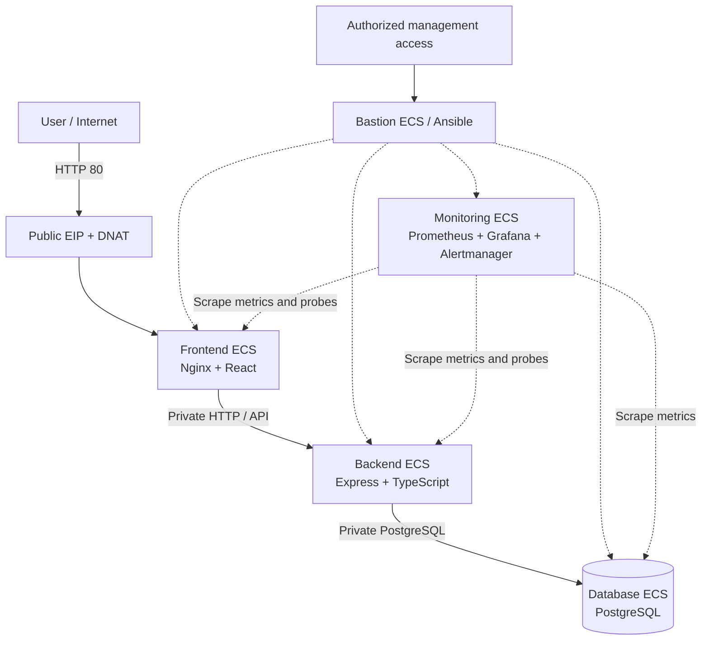

# RoutePilot

### Cloud Infrastructure Automation · DevSecOps · Observability on Huawei Cloud Stack

RoutePilot is an employee transportation planning and route-optimization web application used as the workload for a hands-on **Cloud/DevOps engineering project**. The project brings together a three-tier TypeScript application, segmented infrastructure on **Huawei Cloud Stack (HCS)**, infrastructure provisioning with **Terraform**, host configuration and deployments with **Ansible**, a **Jenkins** delivery pipeline, and monitoring with **Prometheus, Grafana and Alertmanager**.

> **Project focus:** design, provision, secure, automate, deploy and observe a real multi-tier application—not only develop its user interface.

## What the project covers

| Area | Implementation |
| --- | --- |
| Application | React + TypeScript frontend; Express + TypeScript REST API; PostgreSQL with Prisma |
| Business functionality | Employees, pickup locations, fleets, shifts, attendance, transportation plans and route-optimization previews |
| Cloud & networking | Huawei Cloud Stack ECS instances, VPC subnet separation, security groups, NAT/SNAT/DNAT, private tier-to-tier traffic |
| Infrastructure as Code | Terraform configuration for HCS compute, networking and administrative access |
| Configuration & deployment | Ansible roles and playbooks for operating-system setup, Docker, PostgreSQL, application deployment and monitoring services |
| CI/CD & DevSecOps | Jenkins builds and publishes versioned Docker images to GHCR; Trivy vulnerability scans; Ansible-based deployment and post-deployment checks |
| Monitoring | Prometheus, Node Exporter, cAdvisor, PostgreSQL Exporter, application HTTP metrics, Blackbox Exporter, Grafana and Alertmanager |

## Architecture at a glance

The target HCS deployment separates the public-facing application, private API, database, management access and monitoring functions.



**HCS deployment layout:** one VPC, five subnets (frontend, backend, database, edge and management) and five ECS instances (frontend, backend, database, bastion and monitoring). The bastion and monitoring instances share the management subnet; the edge subnet hosts the NAT Gateway. The deployed public HTTP path uses **EIP → DNAT → frontend**, without a load balancer in the validated request path.

The diagram is intentionally simplified. See [Architecture and networking](docs/architecture.md) for routing, access boundaries and environment differences.

## Application capabilities

- Manage employees, pickup points, depots and vehicle fleets.
- Configure shifts, attendance and vehicle availability.
- Preview transportation plans with different optimization strategies and operational constraints.
- Generate and manage transportation plans, with scheduling and reporting screens.
- Use a road-distance and travel-time matrix through an external routing API.

The optimization engine is application code, not a third-party hosted optimizer. Its policies and practical constraints are in `backend/src/optimizer/`. The original problem formulation is documented in [docs/problem-definition.md](docs/problem-definition.md); it describes an earlier scope and should not be treated as a complete specification of the current application.

## Technology stack

| Layer | Technologies |
| --- | --- |
| Web | React 19, TypeScript, Vite, Nginx |
| API | Node.js, Express 5, TypeScript |
| Data | PostgreSQL, Prisma |
| Containers | Docker, Docker Compose (local development), GHCR |
| Infrastructure | Huawei Cloud Stack, Terraform HCS provider |
| Automation | Ansible, Jenkins, GitHub Actions |
| DevSecOps | Trivy vulnerability scanning, Jenkins Credentials, Ansible Vault |
| Observability | Prometheus, Grafana, Alertmanager, Node Exporter, cAdvisor, PostgreSQL Exporter, Blackbox Exporter, prom-client |

## Delivery workflow

1. **Provision** HCS resources and access boundaries with Terraform.
2. **Configure** hosts and services with Ansible roles.
3. **Build** the backend and frontend with Jenkins and create Docker images tagged from a Git commit SHA.
4. **Scan** both images with Trivy, then **publish** them to GitHub Container Registry.
5. **Deploy** the selected images to HCS through Ansible.
6. **Verify** frontend/API connectivity and backend/database checks in Jenkins.
7. **Observe** infrastructure, containers, HTTP services and PostgreSQL using Prometheus dashboards and alerting.

A separate **GitHub Actions** workflow builds the frontend and backend on pushes and pull requests, and publishes Docker images on pushes to `main`. It is distinct from the Jenkins-to-HCS deployment pipeline.

**Security-scan behavior:** the current Jenkinsfile runs Trivy for HIGH/CRITICAL vulnerabilities with `--exit-code 0`, so a finding is reported but does **not** fail the build. Blocking thresholds would require a pipeline change.

See [CI/CD and DevSecOps](docs/cicd.md) and [Monitoring and observability](docs/observability.md).

## Run locally with Docker Compose

**Prerequisites:** Docker Engine / Docker Desktop with Compose, and a valid personal routing API key.

```bash
git clone https://github.com/Nadaaath/routepilot.git
cd routepilot
cp backend/.env.example backend/.env
```

Edit `backend/.env` and supply **your own** valid `ORS_API_KEY`. Do not rely on any value committed in an example file. Then start the services:

```bash
docker compose up --build -d
docker compose ps
```

The Compose stack runs PostgreSQL, the Express API and an Nginx-served React frontend:

- **Application:** http://localhost:8081
- **API health via Nginx:** http://localhost:8081/api/health
- **API readiness:** http://localhost:8081/api/ready

```bash
curl http://localhost:8081/api/health
docker compose logs -f backend
docker compose down
```

The local Compose configuration uses **frontend port 8081 → container port 80**, and an **API service on port 5000**. The HCS deployment uses different host-level routing and API port settings; do not assume that Compose represents the production network.

For requirements and operational caveats, read [Deployment and operations](docs/deployment.md).

## Repository layout

```text
routepilot/
├── backend/                 # Express API, Prisma schema, optimizer
├── frontend/                # React application and Nginx image
├── infrastructure/
│   ├── terraform/           # Huawei Cloud Stack IaC
│   └── ansible/             # Inventory, roles, deployment & monitoring
├── .github/workflows/ci.yml # GitHub Actions builds / GHCR publish
├── Jenkinsfile              # Jenkins pipeline for HCS delivery
├── docker-compose.yml       # Local multi-container setup
└── docs/                    # Project documentation
```

## Technical documentation

- [Architecture and networking](docs/architecture.md)
- [Deployment and operations](docs/deployment.md)
- [CI/CD and DevSecOps](docs/cicd.md)
- [Monitoring and observability](docs/observability.md)
- [Initial optimization problem definition](docs/problem-definition.md)

## Scope and operational notes

- This repository is an **engineering project and demonstrator**, not a claim of production-grade availability, high availability, full automated rollback or formal security certification.
- Its Terraform directory includes configurations from multiple implementation iterations. Review plans carefully against the actual HCS environment before applying changes.
- Environment-specific IP addresses, credentials, vault passwords, API keys and Terraform state are not required to understand this README and should not be shared as reusable deployment settings.
- External routing/geocoding requests require a valid API key and network connectivity.

## Context

Developed as a Cloud / DevOps internship engineering project, using Huawei Cloud Stack as the target infrastructure. The repository documents the application workload and the infrastructure automation, deployment and monitoring work carried out around it.

