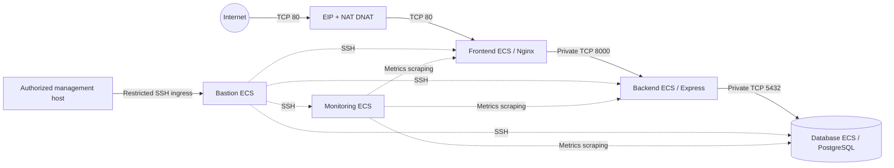

# Architecture and networking

[← Back to README](../README.md)

## 1. Two execution environments

RoutePilot supports a **local Docker Compose** environment and a **Huawei Cloud Stack deployment**. They are related but not identical.

| Concern | Local Compose | HCS deployment |
| --- | --- | --- |
| Frontend | Nginx container; host port 8081 | Frontend ECS, Dockerized Nginx/React on port 80 |
| Backend | Backend container on service port 5000 | Backend ECS; container and host port 8000 |
| Database | PostgreSQL 17 container and Docker volume | Dedicated ECS with PostgreSQL managed by Ansible |
| Network | Compose service-name DNS | HCS VPC, segregated subnets and security groups |
| Public access | localhost:8081 | Public EIP + DNAT to frontend port 80 |
| Deployment | `docker compose` | Jenkins, GHCR and Ansible |
| Monitoring | Not provisioned by Compose | Dedicated monitoring ECS and exporters |

## 2. HCS topology

The checked-in Terraform describes **one VPC** and **five subnets**:

| Subnet | Role |
| --- | --- |
| Frontend | Public-facing Nginx/React workload |
| Backend | Private Express API workload |
| Database | Private PostgreSQL workload |
| Edge | NAT Gateway and network-edge resources |
| Management | Bastion/Ansible management host and monitoring host |

**Five ECS instances** are defined: `routepilot-frontend`, `routepilot-backend`, `routepilot-database`, `routepilot-bastion` and `routepilot-monitoring`. The last two are in the management subnet; the edge subnet is for network services, not a separate application ECS.

### Inbound application traffic

1. The application HTTP entry point is an external EIP and a NAT Gateway DNAT rule.
2. The DNAT rule forwards **TCP 80 to frontend TCP 80**.
3. Nginx serves the React single-page application and proxies `/api/` to the private backend on **TCP 8000**.
4. The backend reaches PostgreSQL privately on **TCP 5432**.

The working ingress path did **not** rely on a load balancer. Port 443 may appear in an allowed security-group rule; that is **not** evidence of a validated HTTPS listener or publicly deployed TLS termination.

### Outbound connectivity

The NAT Gateway is attached to the **edge subnet** in the current `nat.tf` resource reference. SNAT rules are defined for frontend, backend, database and management subnets. Outbound internet access and inbound DNAT are different mechanisms; an SNAT rule does not itself make a private service publicly accessible.

### Security-group boundaries

- Frontend: inbound HTTP/HTTPS rules and SSH from the bastion security group.
- Backend: inbound application traffic from the frontend security group and metrics scraping from monitoring; SSH from bastion.
- Database: inbound PostgreSQL only from the backend security group, plus explicitly allowed monitoring and bastion access.
- Bastion: SSH allowed only from a configured management-source CIDR.
- Monitoring: management-only ingress for dashboards/metrics services; it scrapes specific exporter ports on private hosts.

The management environment assumes a company-controlled jump host and a private SSH administration path. Do not publish working credentials, private keys or real infrastructure inventories as reusable examples.

## 3. Compute and runtime separation

- **Frontend ECS:** runs a Dockerized Nginx static frontend, using an Ansible-generated reverse-proxy configuration for the private API.
- **Backend ECS:** runs a Dockerized Node.js/Express application, with runtime environment injected from a root-protected file. Prisma migrations are applied as part of deployment.
- **Database ECS:** PostgreSQL is installed and configured directly by an Ansible role rather than using the local Compose database container.
- **Bastion ECS:** controlled remote administration and Ansible execution path.
- **Monitoring ECS:** Prometheus, Grafana, Alertmanager and Blackbox Exporter; exporters are deployed to monitored target hosts.

The backend is written in **TypeScript**, compiled to JavaScript for Node.js. Express is the HTTP framework; neither should be represented as a separate physical infrastructure tier.

## 4. Application design

- **React / Vite:** operational screens for staff, attendance, scheduling, locations, vehicles and plans.
- **Express REST API:** controllers, services, repositories and validation.
- **Prisma / PostgreSQL:** persisted employee, shift, fleet, pickup, depot and plan data.
- **Optimization code:** data preprocessing, capacity-aware clustering, vehicle allocation, routing/scheduling logic and cost evaluation.
- **External routing service:** geocoding and road distance/time matrices, dependent on a valid `ORS_API_KEY`.

The source contains different optimization policies and operational planning constraints. Refer to `backend/src/optimizer/` for the implemented logic instead of treating the initial V1 problem statement as a complete description of current functionality.

## 5. IaC source of truth and configuration drift

Terraform resources are located in `infrastructure/terraform/`:

- `network.tf` — VPC and subnets
- `nat.tf` and `public-ingress.tf` — SNAT/DNAT networking
- `security-groups.tf` and `monitoring.tf` — application and monitoring access rules
- `compute.tf` and `monitoring.tf` — application, management and monitoring ECS instances
- `admin-access.tf` — bastion administrative DNAT model

**Important:** committed infrastructure code includes earlier architectural experiments and comments that may not match the last validated deployment. In particular, review obsolete edge-resource declarations before running Terraform against a real project. No reader should infer that every committed resource was actually provisioned or active.

See [Deployment and operations](deployment.md) for usage boundaries.

