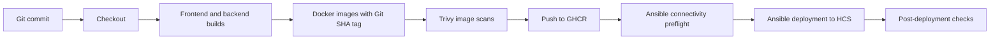

# CI/CD and DevSecOps

[← Back to README](../README.md)

## Delivery responsibilities

RoutePilot has **two CI mechanisms**:

1. **GitHub Actions** (`.github/workflows/ci.yml`) runs frontend/backend dependency installation and builds for pushes/PRs on `main`. On pushes to `main` it builds and publishes Docker images to **GitHub Container Registry (GHCR)**.
2. **Jenkins** (`Jenkinsfile`) runs an HCS-focused pipeline: builds, scans and publishes versioned images, checks private management connectivity, deploys via Ansible and performs HTTP/database verification.

They are independent pipelines, not a single GitHub Actions → Jenkins workflow. A successful GitHub Actions build does not automatically mean the HCS deployment succeeded.

## Jenkins release path

The Jenkinsfile sets `ROUTEPILOT_IMAGE_TAG` from a seven-character Git commit SHA for normal releases and publishes separate frontend and backend images. Ansible pulls these tagged artifacts; the application hosts do not rebuild source code.

### Security checks: actual enforcement level

Trivy scans both images for HIGH and CRITICAL vulnerabilities, with `--ignore-unfixed` and `--exit-code 0`. Thus image vulnerability findings **do not block** image publication in the current pipeline. The scan can provide visibility, but calling it a mandatory pass/fail gate would be inaccurate. A blocking gate requires changing the scan exit policy and validating expected exception handling.

### Credentials and secrets

Jenkins refers to credential IDs for GHCR, SSH and the Ansible Vault password. Ansible renders private backend configuration via an environment template and stores the resulting file with restrictive permissions. These mechanisms are only as secure as their configured Jenkins permissions, Vault management and host security.

Do not expose tokens, SSH private keys, plaintext Vault passwords, CI logs containing credentials, or production environment files. Keep example files limited to variable names and safe placeholders.

## Rollback design

The Jenkinsfile includes a `ROLLBACK_TAG` parameter, intended to select a prior image SHA and verify the corresponding registry artifacts. This documents the **intended** rollback workflow; it is not proof that restoration was tested end-to-end. Validate the rollback logic and stage conditions before relying on it as an incident-recovery control.

## Verification

The Jenkinsfile's post-deployment stage checks the frontend, API path and backend/database connectivity, including Prisma migration status. A successful health check is point-in-time evidence, not continuous availability assurance. Monitoring is handled separately: [Observability](observability.md).

## Improvements to consider

- Turn HIGH/CRITICAL scan results into a deliberate, documented policy (blocking where appropriate).
- Add automated unit and integration tests with measurable coverage; the existing CI currently emphasizes schema validation and compilation.
- Test the rollback path under controlled conditions.
- Add an approved secret-scanning workflow.
- Audit hardcoded environment-specific addresses in deployment/health checks before reuse.
