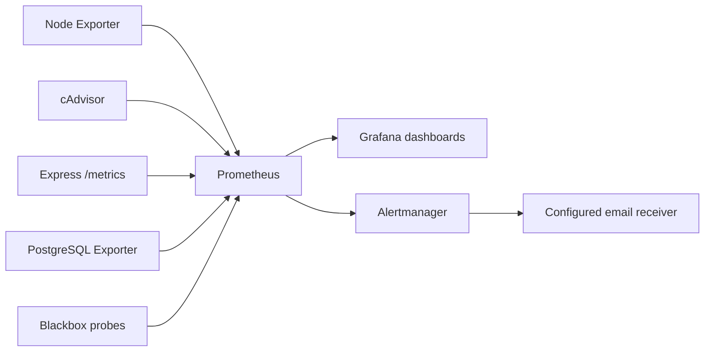

# Monitoring and observability

[← Back to README](../README.md)

## Purpose

CI/CD reports whether a deployment process completed; observability evaluates what happens **after** the workload is running. RoutePilot collects metrics from the ECS hosts, Docker containers, HTTP API, PostgreSQL and active HTTP probes.

## Monitoring components

| Component | Function | Deployment/configuration |
| --- | --- | --- |
| Prometheus | Scraping, querying, recording alert conditions | Monitoring ECS, Ansible `prometheus` role |
| Node Exporter | CPU, memory, filesystem and host metrics | Monitored hosts, `node_exporter` role |
| cAdvisor | Frontend/backend Docker container metrics | Container hosts, `cadvisor` role |
| Express `prom-client` | HTTP metrics and runtime statistics | Backend `/metrics` route and middleware |
| PostgreSQL Exporter | DB health and performance metrics | Database ECS, `postgres_exporter` role |
| Blackbox Exporter | HTTP endpoint probes | Monitoring ECS, `blackbox_exporter` role |
| Grafana | Dashboards and Prometheus datasource | Monitoring ECS, `grafana` role |
| Alertmanager | Routing alert events (email configuration) | Monitoring ECS, `alertmanager` role |

The main scrape configuration is templated in `infrastructure/ansible/roles/prometheus/templates/prometheus.yml.j2`, with a 15-second scrape/evaluation interval in the checked-in configuration.

## Alert conditions

Defined in `infrastructure/ansible/roles/prometheus/templates/alerts.yml.j2`:

- Instance unavailable for at least 1 minute
- CPU over 80% for 5 minutes
- Memory over 85% for 5 minutes
- Backend metrics target unavailable for at least 1 minute
- HTTP 5xx rate over 5% for 5 minutes
- PostgreSQL exporter reporting DB unavailability
- Failed HTTP probe for at least 1 minute
- Root filesystem occupancy warnings over 80%, critical over 90%

Thresholds are values in the template; they are **not** measured performance or reliability results. Confirm metrics exist, targets are healthy and rules are loaded before treating alerts as operationally verified.

## Access and operating model

Prometheus and Grafana are planned as private monitoring services reachable over an authorized management route (including SSH tunneling through the bastion). They are not intended to be globally exposed. The Alertmanager configuration supports SMTP email and resolved-alert notifications; successful email delivery depends on valid Vault-provided credentials and working SMTP connectivity.

## Suggested validation checklist

1. Verify `prometheus`, `grafana-server` and `alertmanager` service status on the monitoring ECS.
2. Inspect Prometheus **Targets** and identify any `DOWN` endpoints.
3. Check that Node Exporter, cAdvisor, backend `/metrics` and PostgreSQL Exporter each return their expected data.
4. Confirm Grafana's provisioned Prometheus datasource and check dashboard query results.
5. Trigger a controlled test condition and inspect Prometheus Alerts plus Alertmanager notification delivery.
6. Restore the service and confirm resolution and recovery.

A dashboard screenshot, successful scrape or resolved alert is useful evidence; avoid claiming a measured SLA or guaranteed incident detection time without a repeatable test record.
